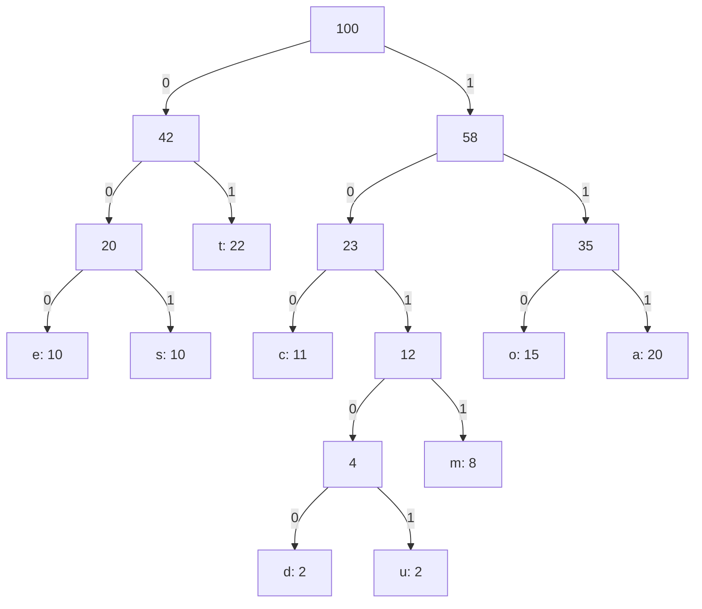

Greedy Approach: Implementation of Huffman Coding
Problem Statement
Given the character frequencies `a: 20, c: 11, d: 2, e: 10, o: 15, m: 8, s: 10, t: 22, u: 2`, where each frequency represents hundreds of occurrences, construct an optimal Huffman code. Show every tree-construction step, list each character's code, and calculate the memory required.
Frequency Table
Character	a	c	d	e	o	m	s	t	u
Frequency units	20	11	2	10	15	8	10	22	2
Total frequency units: 20 + 11 + 2 + 10 + 15 + 8 + 10 + 22 + 2 = 100
Each unit represents 100 occurrences, so the file contains 10,000 characters.
1. Draw the Tree and Show the Work at Every Step
Step	Nodes combined	New frequency
1	d(2) + u(2)	4
2	(4) + m(8)	12
3	e(10) + s(10)	20
4	c(11) + (12)	23
5	o(15) + a(20)	35
6	(20) + t(22)	42
7	(23) + (35)	58
8	(42) + (58)	100
Final Huffman Tree
The left branch represents `0` and the right branch represents `1`.

2. Huffman Encoding for Each Character
Trace the path from the root to each leaf. Write `0` for every left branch and `1` for every right branch.
Character	Frequency units	Huffman code	Code length
a	20	`111`	3
c	11	`100`	3
d	2	`10100`	5
e	10	`000`	3
o	15	`110`	3
m	8	`1011`	4
s	10	`001`	3
t	22	`01`	2
u	2	`10101`	5
3. Calculate the Memory Required
Each frequency unit represents 100 occurrences. For each character, multiply its actual occurrence count by its code length to obtain the number of bits required.
Character	Occurrences	Code	Length	Bits required
a	2,000	`111`	3	6,000
c	1,100	`100`	3	3,300
d	200	`10100`	5	1,000
e	1,000	`000`	3	3,000
o	1,500	`110`	3	4,500
m	800	`1011`	4	3,200
s	1,000	`001`	3	3,000
t	2,200	`01`	2	4,400
u	200	`10101`	5	1,000
TOTAL	10,000	—	—	29,400
Calculation
Weighted code length per frequency unit:
20 × 3 + 11 × 3 + 2 × 5 + 10 × 3 + 15 × 3 + 8 × 4 + 10 × 3 + 22 × 2 + 2 × 5
= 60 + 33 + 10 + 30 + 45 + 32 + 30 + 44 + 10  
= 294 bits per set of 100 occurrences
Each unit represents 100 actual occurrences:
Total encoded bits = 294 × 100 = 29,400 bits
Since 8 bits = 1 byte:
Memory required = 29,400 ÷ 8 = 3,675 bytes
Therefore, the encoded character data requires 29,400 bits (3,675 bytes), excluding storage for the Huffman tree, code table and other metadata.
