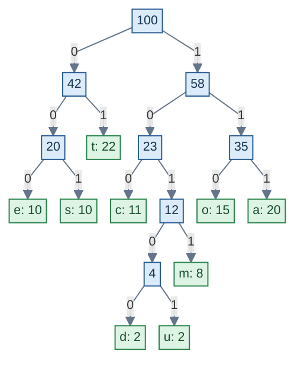

# Greedy Approach: Implementation of Huffman Coding

## Problem Statement

Given the character frequencies `a: 20, c: 11, d: 2, e: 10, o: 15, m: 8, s: 10, t: 22 and u: 2`, where each frequency represents hundreds of occurrences, construct an optimal Huffman code.

1. Draw the tree and show the work at every step.
2. List the Huffman encoding for each character.
3. Calculate the memory required to encode the file.

---

## Frequency Table

| Character | a | c | d | e | o | m | s | t | u |
|:---:|---:|---:|---:|---:|---:|---:|---:|---:|---:|
| Frequency units | 20 | 11 | 2 | 10 | 15 | 8 | 10 | 22 | 2 |

**Total frequency units:**

20 + 11 + 2 + 10 + 15 + 8 + 10 + 22 + 2 = **100**

Each unit represents 100 occurrences.

**Total characters = 100 × 100 = 10,000 characters.**

---

## 1. Huffman Tree Construction

At each step, combine the two nodes with the smallest frequencies. The frequency of the new node is the sum of the two combined frequencies.

| Step | Nodes combined | New frequency |
|---:|---|---:|
| 1 | d(2) + u(2) | 4 |
| 2 | (4) + m(8) | 12 |
| 3 | e(10) + s(10) | 20 |
| 4 | c(11) + (12) | 23 |
| 5 | o(15) + a(20) | 35 |
| 6 | (20) + t(22) | 42 |
| 7 | (23) + (35) | 58 |
| 8 | (42) + (58) | 100 |

### Final Huffman Tree

**Convention:** A left branch represents `0`, and a right branch represents `1`.

### Final Huffman Tree

### Final Huffman Tree

*Left branch = 0 | Right branch = 1*

---

## 2. Huffman Encoding for Each Character

Trace the path from the root to each leaf. Write `0` for every left branch and `1` for every right branch.

| Character | Frequency units | Huffman code | Code length |
|:---:|---:|:---:|---:|
| a | 20 | `111` | 3 |
| c | 11 | `100` | 3 |
| d | 2 | `10100` | 5 |
| e | 10 | `000` | 3 |
| o | 15 | `110` | 3 |
| m | 8 | `1011` | 4 |
| s | 10 | `001` | 3 |
| t | 22 | `01` | 2 |
| u | 2 | `10101` | 5 |

---

## 3. Calculate the Memory Required

Each frequency unit represents 100 occurrences.

For each character:

**Bits required = Actual occurrences × Code length**

| Character | Occurrences | Huffman code | Code length | Bits required |
|:---:|---:|:---:|---:|---:|
| a | 2,000 | `111` | 3 | 6,000 |
| c | 1,100 | `100` | 3 | 3,300 |
| d | 200 | `10100` | 5 | 1,000 |
| e | 1,000 | `000` | 3 | 3,000 |
| o | 1,500 | `110` | 3 | 4,500 |
| m | 800 | `1011` | 4 | 3,200 |
| s | 1,000 | `001` | 3 | 3,000 |
| t | 2,200 | `01` | 2 | 4,400 |
| u | 200 | `10101` | 5 | 1,000 |
| **TOTAL** | **10,000** | — | — | **29,400** |

---

## 4. Calculation

### Weighted code length per frequency unit

20 × 3 + 11 × 3 + 2 × 5 + 10 × 3 + 15 × 3 + 8 × 4 + 10 × 3 + 22 × 2 + 2 × 5

= 60 + 33 + 10 + 30 + 45 + 32 + 30 + 44 + 10

= **294 bits per set of 100 occurrences**

Each frequency unit represents 100 actual occurrences.

**Total encoded bits = 294 × 100 = 29,400 bits**

Since 8 bits = 1 byte:

**Memory required = 29,400 ÷ 8 = 3,675 bytes**

### Final Answer

The encoded character data requires:

- **Total characters:** 10,000
- **Encoded size:** 29,400 bits
- **Memory required:** 3,675 bytes

